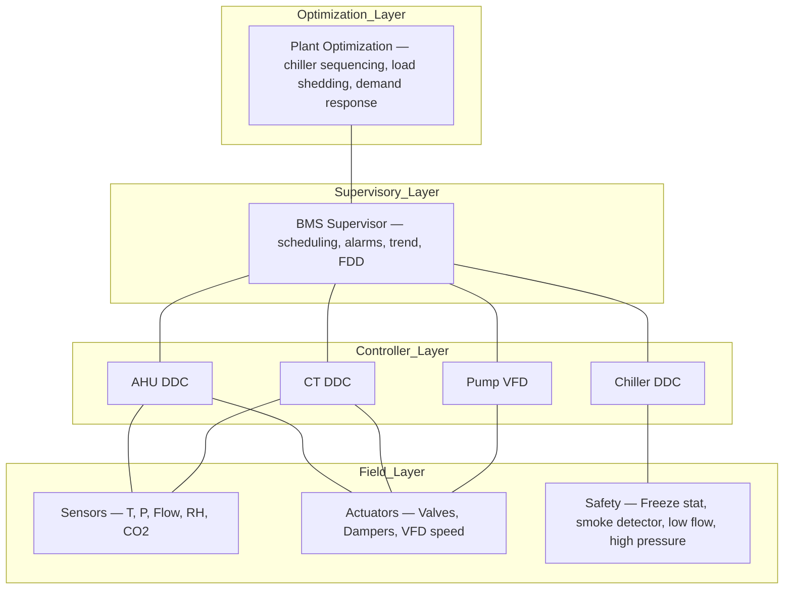
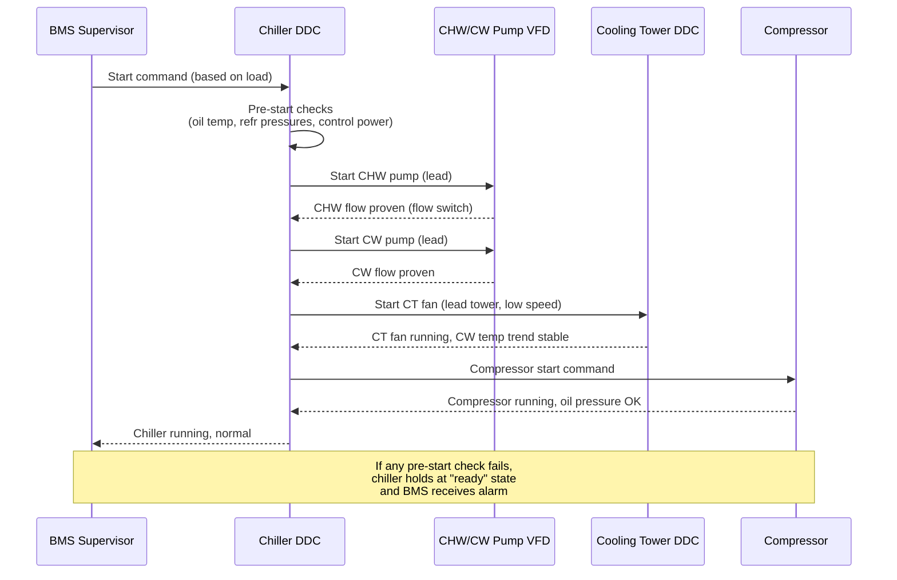
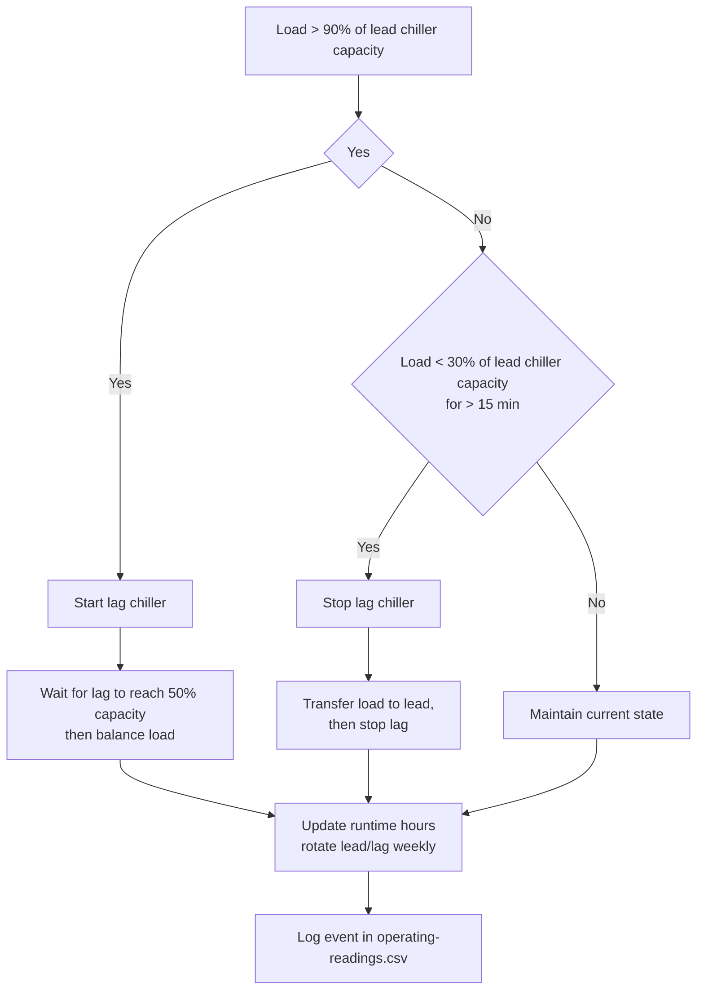
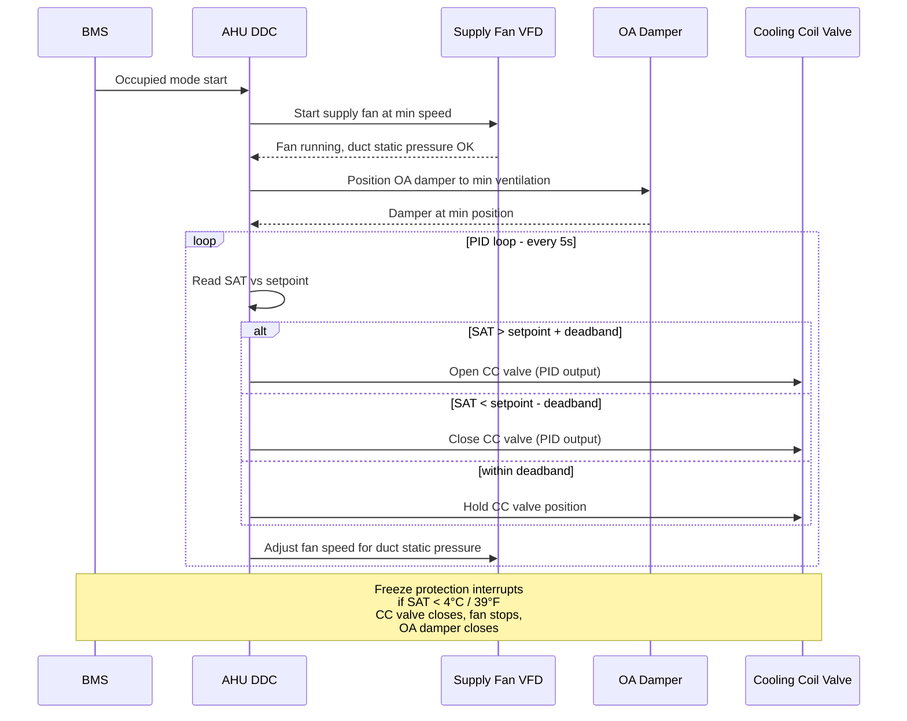
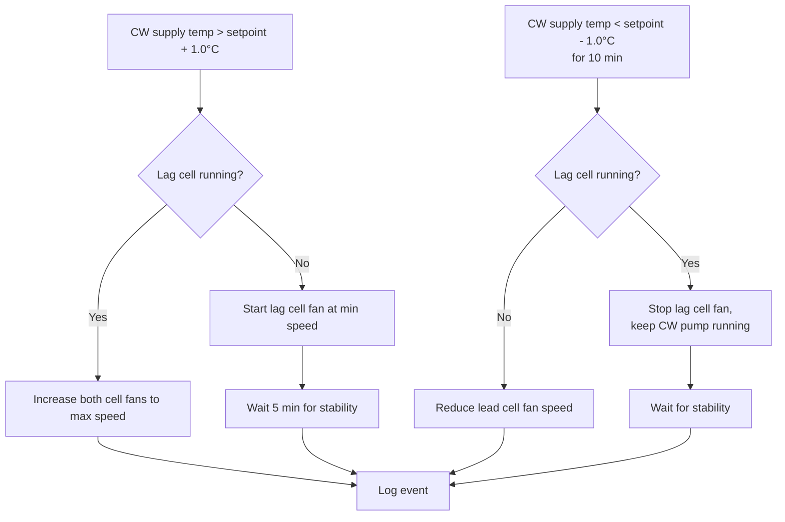
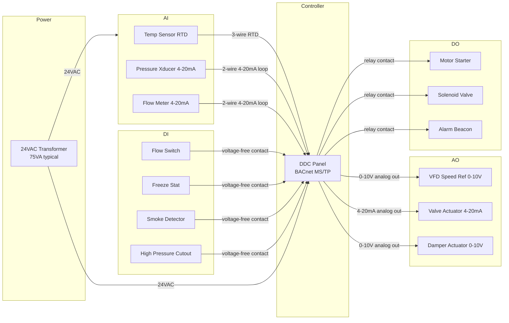

# Control Logic and Wiring

This document describes the control sequences, logic flowcharts, and wiring conventions for an industrial HVAC and cooling plant. It is the procedural reference for the controls layer of the plant and the schematic reference for the wiring infrastructure that connects the BMS to field devices.

The control logic and wiring of an industrial HVAC plant is the layer that turns mechanical equipment into a coordinated system. Without correct controls, well-maintained equipment operates inefficiently, fails to coordinate during load changes, and may trip on safety interlocks that should never have triggered. Without correct wiring, the control logic receives wrong data and actuates wrong outputs. The two are inseparable.

This document is intentionally generic. Every site's control sequences are tuned for its specific load profile, equipment mix, and operational priorities. The sequences here are starting points; site-specific tuning is performed at commissioning and refined over the operational life of the plant.

---

## 1. Control Hierarchy

Industrial HVAC controls follow a hierarchy from field device to plant-wide optimization. Each layer has a defined role; the layers communicate via standardized signals.

### 1.1 Layer Overview



### 1.2 Layer Responsibilities

**Field Layer.** Sensors measure physical quantities (temperature, pressure, flow, humidity, CO2, position). Actuators translate control signals into physical motion (valve position, damper position, fan/pump speed). Safety devices (freeze stat, smoke detector, low flow switch, high pressure cutout) operate independently of the controllers — they interrupt the control circuit directly when triggered. Safety devices are never software-only; they must fail-safe in hardware.

**Controller Layer.** Direct digital controllers (DDC) execute the control logic for each equipment item. The chiller DDC sequences the compressor, the condenser water valve, the CHW isolation valve, and the chiller's own internal safety controls (provided by the chiller manufacturer's controller, integrated via Modbus or BACnet). The AHU DDC sequences the supply fan, the cooling coil valve, the heating coil valve, the outdoor air damper, and the freeze protection sequence. The CT DDC sequences the tower fan(s), the makeup water valve, and the blowdown valve. The pump VFD receives a speed reference from the BMS or from a local PID loop.

**Supervisory Layer.** The BMS supervisor provides scheduling (time-of-day, holiday, occupancy), alarms (active alarm log, alarm history), trend (continuous data logging at user-configured intervals), and FDD (rule-based detection of abnormal conditions). The supervisor does not execute control logic — that is the controller layer's responsibility — but it can override the controllers in emergency (e.g. force a chiller off if a fire alarm is active).

**Optimization Layer.** Plant optimization routines sequence multiple chillers, multiple towers, and multiple pumps to minimize plant energy consumption while meeting the load. Common routines include chiller sequencing (start/stop chillers based on load and efficiency curves), condenser water temperature reset (lower the CW setpoint when wet-bulb allows, to reduce chiller kW per ton), and CHW temperature reset (raise the CHW setpoint when load allows, to reduce chiller kW per ton). Optimization routines sit above the supervisory layer; they may be implemented on the BMS or on a separate analytics platform.

---

## 2. Chiller Plant Sequence of Operation

### 2.1 Start Sequence

The chiller start sequence coordinates the chiller controller, the CHW and CW pumps, the cooling tower fan, and the BMS supervisor. The sequence is timed to ensure that water flow is established before the compressor starts, that the condenser water temperature is within the chiller's operating envelope, and that the chiller's pre-start checks (oil temperature, refrigerant pressures, control power) have completed.



### 2.2 Stop Sequence

The chiller stop sequence reverses the start sequence with appropriate delays to allow the chiller to ramp down, the compressor oil to remain circulating, and the residual cooling to be removed from the CHW loop before the pumps stop.

1. BMS issues stop command (based on load or schedule).
2. Chiller DDC ramps compressor capacity to minimum (or unloads via slide valve / inlet guide vanes).
3. After 60–120 seconds at minimum load, chiller DDC stops the compressor.
4. Chiller DDC waits 180–300 seconds (post-lube cycle) before stopping CHW pump — this allows compressor oil to cool.
5. Chiller DDC stops CHW pump.
6. Chiller DDC commands CT fan to low speed (or stops if multiple towers and another chiller is running).
7. Chiller DDC commands CW pump to stop (after delay, if no other chiller is using CW).
8. BMS receives "chiller stopped" confirmation.

### 2.3 Lead/Lag Sequencing

When multiple chillers are installed, the BMS sequences them based on load and runtime. The typical sequence:



Lead/lag rotation is critical for equipment health. A chiller that is always lead accumulates run hours disproportionately and fails earlier; a chiller that is always lag may develop bearing brinelling from continuous standstill. Rotate weekly (or per OEM recommendation) and confirm that the lag chiller runs at least 4 hours per week to maintain bearing lubrication.

---

## 3. AHU Sequence of Operation

### 3.1 Cooling Mode

The AHU cooling mode sequence controls the supply fan, the outdoor air damper, the cooling coil valve, and the supply air temperature. The sequence is designed to deliver the supply air temperature setpoint at minimum energy cost, with adequate ventilation for occupancy.



### 3.2 Economizer Mode

When outdoor air conditions are favorable (outdoor air enthalpy is lower than return air enthalpy), the AHU uses outdoor air for free cooling instead of mechanical cooling. The sequence:

1. BMS reads outdoor air temperature and humidity, computes outdoor air enthalpy.
2. BMS reads return air temperature and humidity, computes return air enthalpy.
3. If outdoor enthalpy < return enthalpy AND outdoor temperature < supply air setpoint + 2 °C, economizer mode is enabled.
4. BMS opens OA damper to 100%, closes return air damper to 0%, modulates cooling coil valve to maintain SAT setpoint.
5. If economizer mode cannot maintain SAT (outdoor air too warm), BMS reverts to minimum outdoor air and modulates cooling coil valve.

### 3.3 Supply Air Temperature Reset

Supply air temperature reset reduces energy consumption by raising the SAT setpoint when the zone load is low. The reset strategy:

- At zone temperature below setpoint, SAT setpoint is at the high end (e.g. 15 °C / 59 °F).
- At zone temperature above setpoint, SAT setpoint is at the low end (e.g. 13 °C / 55 °F).
- Reset is linear between these bounds, applied over a 1 °C zone temperature band.

Reset reduces reheat energy (in VAV systems) and reduces chiller loading (because the CHW coil valve is less open). It is one of the highest-ROI control sequences in commercial HVAC; ensure it is implemented and tuned.

### 3.4 Freeze Protection

Freeze protection is a safety sequence that overrides normal control when the supply air temperature approaches freezing. The sequence:

1. If SAT < 4 °C / 39 °F (configurable; consult OEM), the freeze protection sequence activates.
2. Cooling coil valve drives to closed.
3. Outdoor air damper drives to closed.
4. Supply fan continues to run (to circulate warm return air over the coil and prevent coil rupture).
5. Heating coil valve (if fitted) opens to reheat the supply air.
6. If SAT does not recover above 7 °C / 45 °F within 5 minutes, supply fan stops and BMS raises a critical alarm.
7. Reset is manual — the operator investigates the cause (failed mixing damper, failed heating valve, low CHW temperature with no airflow) before resetting.

The freeze stat is a hardware device independent of the BMS — it interrupts the supply fan control circuit directly. The BMS readback is for alarm and trend; the safety action is in hardware.

---

## 4. Cooling Tower Sequence of Operation

### 4.1 Fan Control

The cooling tower fan is controlled to maintain the condenser water supply temperature setpoint (typically 27–32 °C / 80–90 °F depending on outdoor wet-bulb). The sequence:

1. BMS reads CW supply temperature.
2. BMS compares to setpoint.
3. If CW supply > setpoint + 0.5 °C, fan speed increases (VFD) or next fan stage starts (multi-speed).
4. If CW supply < setpoint - 0.5 °C, fan speed decreases or fan stage stops.
5. Minimum fan speed is 20% (VFD) — below this, fan airflow is insufficient for effective heat transfer and the fan should be cycled on/off instead.

### 4.2 Multi-Cell Sequencing

When multiple tower cells are installed, the BMS sequences them based on load. The sequence:



### 4.3 Water Treatment Interlocks

The cooling tower water treatment system (biocide dosing, blowdown) is interlocked with tower operation:

- Biocide dosing runs on a timer (e.g. 1 hour per day) when the tower fan is running. Dosing while the tower is idle dilutes the biocide and wastes chemical.
- Blowdown is triggered by conductivity exceeding the setpoint. Blowdown while the tower is idle is acceptable (it removes concentrated water that has been sitting in the sump).
- Makeup water is triggered by sump level below the low-level setpoint. The makeup valve is independent of the BMS in most installations (it is a float valve), but the BMS monitors makeup water consumption via a flow meter — continuous makeup water indicates a leak in the system or a stuck blowdown valve.

---

## 5. Pump and Fan VFD Control

### 5.1 Differential Pressure Control (CHW Pumps)

Variable-speed CHW pumps are controlled to maintain a differential pressure setpoint at the hydraulically remote load (the most demanding AHU or terminal). The sequence:

1. BMS reads DP at the remote sensor.
2. PID loop computes pump speed.
3. VFD receives speed reference (0–10 V or 4–20 mA analog signal, or BACnet/Modbus digital value).
4. VFD adjusts pump motor speed to match the reference.

The remote sensor location is critical. A sensor at the pump discharge measures pump head, not system head; the pump will short-cycle and the system will starve. A sensor at the most remote load measures the actual system pressure available to the loads, which is the control variable.

### 5.2 Staged Pump Sequencing (Constant Speed Pumps)

For constant-speed primary/secondary pumping (legacy or large industrial installations), the BMS stages pumps based on load. The sequence:

1. BMS reads CHW flow (primary loop vs. secondary loop).
2. If secondary flow > primary flow for > 5 minutes, BMS starts lag primary pump.
3. If primary flow > secondary flow × 1.5 for > 15 minutes, BMS stops lag primary pump.

The "decoupler" pipe between primary supply and primary return allows flow imbalance without pump damage — the decoupler flow direction indicates the imbalance.

### 5.3 VFD Failure Mode

If the VFD fails, the pump motor cannot run (modern VFDs do not have a bypass contactor by default). The BMS raises a critical alarm and the standby pump starts automatically. The standby pump should be tested monthly (manual start, confirm operation, return to standby). The test is logged in `pump-fan-bearing-inspection.csv` with `notes` = `standby test`.

---

## 6. Wiring Conventions

### 6.1 Signal Categories

HVAC controls wiring falls into four categories, each with specific requirements for cable type, shielding, and termination.

| Category | Signal type | Cable | Shield | Notes |
|----------|-------------|-------|--------|-------|
| AI | Analog Input (4–20 mA, 0–10 V, RTD, thermistor) | Twisted pair, shielded | Yes, drain at controller | RTD uses 3-wire or 4-wire for accuracy |
| AO | Analog Output (4–20 mA, 0–10 V to VFDs, valve/damper actuators) | Twisted pair, shielded | Yes, drain at controller | Verify actuator input matches output type |
| DI | Digital Input (24 VAC/VDC, voltage-free contact) | Twisted pair, unshielded acceptable for short runs | Optional | Common return wire required |
| DO | Digital Output (24 VAC triac, 24 VDC transistor, relay contact) | Twisted pair, sized for load | No | Confirm output rating matches load (triac cannot drive DC, relay cannot drive high inrush) |

### 6.2 Wiring Block Diagram

The diagram below shows the typical wiring topology from BMS controller to field devices on a chiller plant. The wiring block is generic; specific terminals, wire colours, and shield connections follow the BMS manufacturer's documentation.



A full-resolution PNG of this diagram is in `diagrams/control-wiring-block.png` for ease of printing and posting in the plant room.

### 6.3 Shielding and Grounding

Analog signal cables (AI and AO) are shielded. The shield drain wire is terminated at the controller end only — terminating at both ends creates a ground loop that picks up noise. The shield is continuous from sensor to controller; intermediate junctions maintain the shield through a shielded terminal block.

The controller panel has a dedicated signal ground bus, isolated from the power ground. All shield drains land on this bus. The signal ground bus is bonded to the building ground at one point only — typically at the controller panel's power entry.

Digital signal cables (DI and DO) are typically unshielded for runs under 30 m; longer runs or runs in high-noise environments (near VFDs, near large motors) are shielded with the same drain-at-controller-only convention.

### 6.4 Wire Sizing

Wire sizing follows local electrical code (NEC in the US, IEC 60364 internationally). Typical wire gauges for HVAC controls:

| Application | Wire gauge (AWG) | Wire gauge (metric) |
|-------------|-------------------|----------------------|
| AI / AO signal (short run < 30 m) | 18 AWG | 0.75 mm² |
| AI / AO signal (long run 30–100 m) | 16 AWG | 1.0 mm² |
| DI / DO signal | 18 AWG | 0.75 mm² |
| 24 VAC power to field devices | 14 AWG | 2.5 mm² |
| 120 VAC power to controllers | 12 AWG | 4.0 mm² |
| Equipment grounding | 14 AWG minimum | 2.5 mm² minimum |

VFD output wiring (to the motor) requires special consideration — VFD output is high-frequency PWM that radiates noise. Use VFD-rated cable (symmetrical construction with three conductors and three drain wires) for the entire motor lead length. Terminate the shield at both ends (VFD output ground lug and motor junction box ground lug). Do not exceed the VFD manufacturer's maximum motor lead length without consulting the manual — long leads cause reflected wave overvoltage that damages motor insulation.

---

## 7. Safety Interlocks

### 7.1 Hardware Safety Interlocks

The following safety devices interrupt the control circuit directly, independent of the BMS. They cannot be overridden by software; they reset only manually after investigation.

| Device | Trip point | Action | Reset |
|--------|-----------|--------|-------|
| Freeze stat (AHU) | SAT < 4 °C / 39 °F | Stop fan, close OA damper, open heating valve | Manual |
| Smoke detector (AHU) | Smoke in supply or return duct | Stop supply fan, close smoke dampers, fire alarm integration | Manual, after fire authority clearance |
| Low flow switch (chiller CW) | CW flow < setpoint | Stop chiller compressor | Automatic when flow restores; chiller requires restart command |
| High pressure cutout (chiller) | Discharge pressure > OEM limit | Stop compressor | Manual |
| Low pressure cutout (chiller) | Suction pressure < OEM limit | Stop compressor | Automatic or manual per OEM |
| Oil pressure differential (chiller) | Oil pressure < OEM limit | Stop compressor | Manual |
| Motor overload (chiller, pump, fan) | Motor current > FLA × 115% | Stop motor | Manual |
| Sump low level (cooling tower) | Sump level below low-low | Stop tower fan (prevent pump cavitation if pump runs dry) | Automatic when level restores |

### 7.2 Software Interlocks

Software interlocks are programmed in the BMS or DDC and can be overridden (with proper authorization) for testing or maintenance. They include:

- Chiller cannot start if CHW pump is not running.
- Chiller cannot start if CW pump is not running.
- Chiller cannot start if CT fan is not running (where the chiller requires active heat rejection).
- AHU supply fan cannot start if the cooling coil valve is open > 50% (prevents cold air dumping on occupants).
- Cooling tower fan cannot start if sump level is below low level.
- Standby pump starts automatically if lead pump fails.

Software interlocks are documented in the BMS programming and in this guide. They are tested during commissioning and annually during the full controls test (part of the annual service, Section 6 of `inspection-methodology.md`).

### 7.3 LOTO and Control System Work

When equipment is isolated under LOTO for mechanical or electrical work, the BMS controls for that equipment must be placed in "out of service" or "maintenance" mode. This prevents the BMS from issuing start commands to equipment that is isolated, which could damage the equipment or injure personnel.

The "out of service" mode is set by the technician at the BMS user interface before LOTO is applied. The mode is verified by a second person. The mode is reset only after LOTO is removed and the equipment is verified safe to return to service.

If the BMS does not support "out of service" mode (legacy or basic BMS), the alternative is to disable the relevant control outputs at the controller — typically by disconnecting the output wire at the controller terminal and labelling it "DO NOT RECONNECT — LOTO IN PROGRESS". This is less elegant than software mode but is equally safe if executed correctly.

---

## 8. BMS Point List and Naming Convention

### 8.1 Point Naming

Every BMS point should have a unique name that follows a documented convention. The recommended convention:

```
<SITE>-<PLANT>-<EQ-ID>-<SIGNAL>-<DESCRIPTION>
```

For example: `PLT-CHL-001-A-CHWS-T` for chiller 001, analog input, CHW supply temperature.

The convention must be documented in a site-specific addendum; without documentation, point names drift over time as different technicians apply their own conventions. The BMS point list (a spreadsheet listing every point, its name, its description, its range, its unit, and its controller) is a controlled document maintained alongside the asset register.

### 8.2 BMS Point Categories

| Category | Examples | Notes |
|----------|----------|-------|
| Temperature | CHW supply, CHW return, CW supply, CW return, SAT, RAT, OAT, WBT | RTD or thermistor |
| Pressure | Suction, discharge, oil, filter dp, duct static | 4–20 mA transmitter |
| Flow | CHW flow, CW flow, outdoor air flow | Magnetic or ultrasonic |
| Electrical | Motor amps, motor kW, motor VFD output Hz | From VFD or power meter |
| State | Equipment run status, fault status, mode | Digital input |
| Position | Damper position, valve position, VFD speed % | Analog input |
| Calculated | Load (kW), efficiency (kW/ton), approach | Computed by BMS |

### 8.3 Trend Logging Intervals

| Point class | Trend interval | Notes |
|-------------|----------------|-------|
| Chiller operating readings | 5 min | Captures load changes without saturating storage |
| AHU operating readings | 15 min | Adequate for trend analysis; daily for SAT |
| Cooling tower readings | 15 min | Adequate for approach trending |
| Equipment run status | On change | Trend only transitions to save storage |
| Alarms | On change | Trend all alarms and returns to normal |
| Setpoints | On change | Trend setpoint changes for audit |

Trend data is stored in the BMS supervisor's database and exported to `operating-readings.csv` for analysis outside the BMS environment.

---

## 9. Sequence of Operation Documentation

### 9.1 Documentation Requirement

Every control sequence must be documented in writing. The documentation includes: the sequence description (the steps in plain language), the setpoints and tuning parameters, the alarms and interlocks, and the BMS point list referenced by the sequence.

The documentation is maintained in this repository (this document and site-specific addenda). The BMS programming (the actual code that implements the sequence) is maintained in the BMS project file (vendor-specific format); a PDF export of the programming is filed in the maintenance office as a snapshot at each major revision.

### 9.2 Sequence Review

The documented sequences are reviewed annually by the maintenance manager and a controls engineer. The review confirms that the documented sequence matches the implemented BMS programming (drift between documentation and implementation is common), that the setpoints and tuning parameters are still appropriate for the current load profile, and that the alarms and interlocks have been tested in the past 12 months.

Drift between documentation and implementation is the single most common cause of "mysterious" equipment behaviour. A technician troubleshooting a chiller that starts at the wrong time discovers that the documented sequence says "start at 80% load" but the implemented sequence says "start at 70% load" — and the implementation has been wrong for two years. The annual sequence review catches and corrects this drift.

---

## 10. References to PNG Diagrams

The following PNG schematic diagrams are provided in `diagrams/` for reference and printing:

- `diagrams/refrigerant-cycle.png` — Refrigerant cycle on a water-cooled centrifugal chiller, showing compressor, condenser, expansion device, evaporator, and key pressure/temperature points.
- `diagrams/chilled-water-system.png` — Chilled water and condenser water loop topology, showing chiller, pumps, cooling tower, AHU, and key sensors.
- `diagrams/control-wiring-block.png` — Wiring block diagram from BMS DDC panel to field devices, showing AI, AO, DI, DO signal categories and power supply.
- `diagrams/bms-network-architecture.png` — Three-tier BMS network architecture, showing field controllers, supervisor, and user interface tier with protocols.
- `diagrams/pm-schedule-gantt.png` — Sample Gantt chart of preventive maintenance tasks for Q1.

These diagrams are generated by the script in `/home/z/my-project/scripts/generate_diagrams.py` (referenced in this private copy; the script is not part of the public template repository, which contains only the generated PNG outputs).
