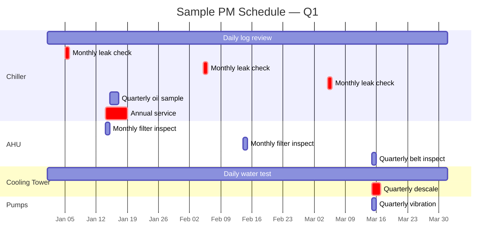

# Preventive Maintenance Planning

This document describes how to plan, schedule, prioritize, and review preventive maintenance (PM) for an industrial HVAC and cooling plant. It is the procedural reference for the `preventive-maintenance-schedule.csv` template. The goal of PM planning is not to maximize PM activity but to maximize equipment availability and energy efficiency at the lowest lifecycle cost — which often means doing less PM more intelligently, not more PM by default.

PM planning is a continuous activity, not an annual exercise. The schedule is reviewed monthly, recalibrated quarterly, and overhauled annually. The schedule is the operational expression of the maintenance strategy; the records produced by executing the schedule are the audit trail that the strategy is being followed.

---

## 1. PM Strategy

### 1.1 Reactive, Preventive, Predictive, and Prescriptive Maintenance

Four maintenance philosophies coexist on a typical HVAC plant. Each has its place; each is appropriate for some assets and inappropriate for others.

**Reactive maintenance** (run-to-failure) is appropriate for assets with low criticality, low cost of failure, and easy replacement — a $200 exhaust fan in a storage area is a classic candidate. The PM schedule for such assets contains only inspection tasks (to detect failure early); no scheduled replacement.

**Preventive maintenance** (time-based or run-hour-based) is appropriate for assets where failure modes are age-related and where the cost of failure exceeds the cost of prevention. Belts, filters, oil, and bearings typically follow time-based PM. The PM schedule for such assets contains scheduled replacement tasks at the appropriate interval.

**Predictive maintenance** (condition-based) is appropriate for assets where failure modes are random (not age-related) and where condition can be monitored. Compressor bearings, motor windings, and refrigerant charge typically follow condition-based PM — the asset is inspected, condition is assessed, and replacement is scheduled only when condition indicates imminent failure. The PM schedule for such assets contains inspection and trending tasks; replacement is triggered by trend, not by schedule.

**Prescriptive maintenance** (OEM-directed) is appropriate for assets under OEM warranty or service contract, where the OEM specifies the maintenance regime and the site's role is to execute or witness it. Chillers under OEM service contract typically follow prescriptive maintenance — the OEM specifies the service scope, the schedule, and the parts. The site PM schedule for such assets is aligned with the OEM schedule.

The asset register's `criticality` field, combined with the failure mode analysis in Section 2, drives the maintenance philosophy selection for each asset.

### 1.2 Maintenance Strategy Matrix

The matrix below provides a starting point for selecting the maintenance philosophy for each equipment class. Site-specific deviation should be documented in the asset register `notes` field.

| Equipment class | Criticality | Philosophy | PM interval basis |
|-----------------|-------------|------------|-------------------|
| Centrifugal chiller | Critical | Predictive + Prescriptive | OEM contract + quarterly oil analysis + annual EDD leak test + 5-year eddy-current |
| Screw chiller | Critical | Predictive + Prescriptive | OEM contract + quarterly oil analysis + annual leak test |
| AHU on critical zone | High | Preventive | Monthly inspection, quarterly belt, annual full service |
| AHU on standard zone | Medium | Preventive | Monthly inspection, semi-annual belt, annual service |
| Cooling tower | Critical | Preventive + Prescriptive | Daily water test, weekly visual, monthly full, annual service |
| Primary CHW/CW pump | High | Predictive | Monthly vibration + annual service |
| Standby CHW/CW pump | High | Preventive | Quarterly test run + annual service |
| Exhaust fan (storage) | Low | Reactive | Quarterly visual only |
| VFD on critical pump | High | Predictive | Monthly thermal image + annual capacitor inspection |
| BMS supervisor | Critical | Prescriptive | OEM contract + annual backup verify |

### 1.3 Run-Hour Versus Calendar-Based Intervals

Some failure modes are run-hour related (bearing wear, oil degradation, filter loading); others are calendar related (corrosion, seal hardening, biological growth). Use the failure mode to select the interval basis. Belts, filters, oil, and bearings on continuously running equipment use run-hour intervals; biocide dosing, drain trap priming, and outdoor air damper exercise use calendar intervals. For equipment with run-hour intervals, the BMS run-hour counter is the source of truth; calendar intervals are secondary triggers ("replace by month if not yet reached by run-hours").

The `preventive-maintenance-schedule.csv` template carries both `frequency_days` and `frequency_hours_run` columns to support this dual-trigger pattern. Either field may be blank if not applicable; the scheduling system uses whichever trigger fires first.

---

## 2. Failure Mode and Effects Analysis (FMEA)

A formal FMEA at the asset class level identifies the failure modes that PM should address. The FMEA does not need to be exhaustive; it needs to cover the failure modes that have historically caused unplanned downtime on the asset class, plus the failure modes that are safety-relevant.

### 2.1 Centrifugal Chiller FMEA Summary

| Failure mode | Cause | Effect | Detection | PM action |
|--------------|-------|--------|-----------|-----------|
| Tube failure (condenser/evaporator) | Erosion, corrosion, freeze | Refrigerant/water mix, chiller shutdown | Eddy current test, water in refrigerant | 5-year eddy current test |
| Compressor bearing failure | Wear, lube degradation, surge | Compressor shutdown, possible impeller damage | Vibration trend, oil analysis | Quarterly oil analysis, vibration monitoring |
| Refrigerant leak | Joint failure, vibration fatigue | Loss of charge, performance loss | Electronic leak detector, charge trend | Monthly leak check (F-Gas) |
| Oil contamination | Moisture ingress (purge unit), acid formation | Bearing wear, compressor damage | Oil analysis (moisture, TAN) | Quarterly oil analysis |
| Tube fouling (condenser) | Scaling, biological growth | High condenser pressure, performance loss | Approach temperature trend | Quarterly tube inspection, descale as needed |
| Motor winding degradation | Overheating, VFD-induced shaft currents | Motor failure | IR test, polarization index | Annual electrical inspection |
| Starter / VFD failure | Capacitor aging, contact wear | Chiller unable to start | Visual, capacitor swell, firmware log | Annual inspection |

### 2.2 AHU FMEA Summary

| Failure mode | Cause | Effect | Detection | PM action |
|--------------|-------|--------|-----------|-----------|
| Filter bypass / collapse | Wrong filter, frame damage | Unfiltered air to coil, IAQ issue | Visual, filter dp too low | Monthly inspection |
| Coil freeze | Failed mixing damper, low CHW temp with no airflow | Coil rupture, water damage | Mixing damper stroke test, freeze stat | Annual service + freeze stat test |
| Belt failure | Misalignment, tension, age | AHU shutdown, no airflow | Visual, tension, vibration | Quarterly inspection, annual replacement |
| Bearing failure | Wear, over/under-greasing, VFD currents | Fan shutdown, possible fan damage | Temperature trend, vibration | Monthly trend, annual grease |
| Condensate overflow | Clogged drain, dry trap | Water damage, biological growth | Visual, drain pan condition | Monthly inspection |
| Damper actuator failure | Linkage, motor, control signal | Ventilation wrong, energy waste | Stroke test, BMS comparison | Annual service |
| Coil fouling | Particulate, biological growth | Performance loss, IAQ | Visual, dp trend | Annual cleaning |

### 2.3 Cooling Tower FMEA Summary

| Failure mode | Cause | Effect | Detection | PM action |
|--------------|-------|--------|-----------|-----------|
| Fill fouling | Scale, biological growth | Performance loss, drift of droplets carrying bacteria | Visual, approach trend | Quarterly inspection, descale |
| Drift eliminator failure | Damage, fouling, age | Legionella dispersal risk | Visual | Quarterly inspection |
| Fan blade failure | Crack, leading-edge erosion, balance | Fan vibration, blade liberation | Visual, vibration | Annual inspection |
| Gearbox failure | Oil contamination, wear | Tower shutdown | Oil analysis, vibration | Quarterly oil sample, annual oil change |
| Water treatment failure | Biocide dosing pump, control, drum empty | Legionella amplification | Daily water test, biocide residual | Daily monitoring, water management plan |
| Sump sediment accumulation | Makeup water solids, low flow | Clogged strainers, pump damage | Visual | Quarterly sump cleaning |
| Fan motor failure | Bearing, winding, VFD | Tower shutdown | Temperature, vibration, IR | Annual service |

### 2.4 Pump FMEA Summary

| Failure mode | Cause | Effect | Detection | PM action |
|--------------|-------|--------|-----------|-----------|
| Bearing failure | Wear, lube, VFD currents, misalignment | Pump shutdown, possible shaft damage | Temperature trend, vibration trend | Monthly trend, annual grease |
| Mechanical seal failure | Wear, dry running, contamination | Water leak, pump shutdown | Visual | Annual inspection |
| Impeller wear / erosion | Cavitation, suspended solids | Performance loss | Flow trend, vibration spectrum | Annual inspection |
| Shaft misalignment | Thermal growth, foundation movement | Bearing wear, coupling wear | Laser alignment | Annual alignment check |
| Motor winding degradation | Overheating, VFD currents | Motor failure | IR test, polarization index | Annual electrical inspection |
| VFD failure | Capacitor aging, fan failure | Pump unable to run | Visual, firmware log, thermal image | Annual inspection |

---

## 3. PM Schedule Construction

### 3.1 Schedule Template

The `preventive-maintenance-schedule.csv` template carries one row per PM task. Each task references: an `asset_id` (which asset the task applies to), a `task_description` (what is to be done), `frequency_days` and `frequency_hours_run` (when it is due), `last_completed_date` and `next_due_date` (scheduling state), `procedure_ref` (the section of `inspection-methodology.md` that defines the procedure), `assigned_to` (the role responsible), `typical_duration_min` (for labour planning), `parts_required` (for inventory planning), `priority` (for sequencing), `safety_critical` (yes/no, for sign-off requirements), `regulatory_ref` (the standard that drives the task, where applicable), and `notes` (free text).

### 3.2 Frequency Calibration

The default frequencies in the FMEA-driven schedule should be calibrated after the first 12 months of operation. The calibration uses the actual failure mode distribution observed on the plant — if no bearing failure has been detected in 12 months despite monthly vibration readings on a particular asset class, the reading frequency can be reduced from monthly to quarterly, freeing resource for higher-value tasks. The calibration is documented in the asset register `notes` field and in the schedule `notes` field.

### 3.3 Schedule Sequencing

PM tasks on the same asset are sequenced to minimize downtime. A monthly inspection that requires the asset to be offline is sequenced to occur in the same window as the quarterly belt replacement, so the asset is offline once not twice. The scheduling system (BMS, CMMS, or spreadsheet) supports this sequencing; the `typical_duration_min` field allows the planner to forecast labour hours per week and identify conflicts.

### 3.4 Spare Parts Stocking

The `parts_required` field drives the spare parts stocking strategy. Parts that are required by a PM task are stocked at a level sufficient to cover the next PM cycle plus a safety margin. Parts that are required by a likely fault (FMEA-driven) are stocked at a level sufficient to cover one replacement. Parts that are not stocked (long-lead OEM parts) are pre-ordered at a defined lead time before the PM window — typically 60 days for chiller compressor parts, 30 days for AHU coils, 14 days for pump mechanical seals.

---

## 4. Fault Detection and Diagnostics (FDD) Integration

Modern BMS platforms include FDD routines that automatically detect abnormal conditions based on trend data. FDD detection should be integrated with the fault log to ensure that BMS-detected faults are recorded and acted on with the same discipline as human-detected faults.

### 4.1 Typical FDD Rules

| Rule | Detection | Action |
|------|-----------|--------|
| Chiller surge | Compressor amps oscillating > 10% over 60s | Investigate load/condenser conditions |
| Simultaneous heating and cooling | AHU coil valves open simultaneously > 5 min | Investigate controls, override or fix |
| CHW supply temp drift | CHWST deviates from setpoint > 0.5 °C for > 15 min | Investigate chiller loading, flow |
| Outdoor air damper stuck | Damper position command unchanged > 5% for > 24h | Investigate actuator, control sequence |
| Filter loading trend | Filter dp increasing > 10% per week | Schedule filter change |
| Bearing temperature trend | Bearing temp increasing > 2 °C per week | Schedule bearing inspection |
| Tower approach drift | Approach increasing > 1 °C per month | Schedule descale, fill inspection |
| VFD fault | VFD fault code active | Investigate, reset or replace |
| Sensor stuck | Sensor value unchanged > 1h while equipment running | Investigate sensor, signal wiring |

### 4.2 FDD-to-Fault-Log Integration

When an FDD rule triggers, the BMS writes an entry to its alarm log. The site's daily operator round (Section 2 of `inspection-methodology.md`) reviews the alarm log and creates a corresponding entry in `fault-corrective-log.csv` with `fdd_flag` = `yes` and `bms_alarm_id` = the BMS alarm identifier. The fault is then investigated and resolved like any human-detected fault.

This integration is essential to closing the loop — without it, FDD alarms accumulate in the BMS but are not acted on, and the FDD investment delivers no operational value. The fault log is the operational record; the BMS alarm log is the audit trail of detection.

---

## 5. Risk-Based Prioritization

Not every PM task is equally important. When resource is constrained (technician unavailable, parts not in stock, asset cannot be taken offline at the planned time), prioritization is required. The recommended prioritization uses a 2 × 2 matrix: safety criticality (yes / no) on one axis, operational criticality (critical / high / medium / low, from the asset register) on the other.

### 5.1 Priority Matrix

| Priority | Safety critical | Operational criticality | Action on conflict |
|----------|----------------|--------------------------|---------------------|
| P1 — do now | Yes | Critical / High | Reschedule other work, escalate to maintenance manager |
| P2 — this week | Yes | Medium / Low | Reschedule within current week |
| P3 — this month | No | Critical / High | Reschedule within current month |
| P4 — flexible | No | Medium / Low | Reschedule within current quarter |

### 5.2 Backlog Management

A PM backlog is normal — not every PM task is completed on the planned day. The backlog is monitored monthly: the count of overdue PM tasks by priority, the average days overdue, and the count of overdue tasks that are safety-critical. A growing backlog, particularly of safety-critical tasks, is a leading indicator that the maintenance strategy is mismatched to the available resource and that the strategy must be revised (more predictive maintenance, less preventive; more contractors; more spare parts; more redundancy).

The `preventive-maintenance-schedule.csv` template's `last_completed_date` and `next_due_date` columns support backlog calculation — a task is overdue if `next_due_date` is before today's date.

---

## 6. Annual Review

### 6.1 Annual Review Scope

The annual PM review is the most significant planning event of the year. It typically occurs 30–60 days before the start of the new fiscal or calendar year and produces the next year's PM schedule. The scope includes: review of the previous year's PM completion (completion rate, backlog trend, average days late); review of the previous year's faults (count, distribution, root cause, recurrence); FMEA review (update failure mode list based on the year's experience); frequency calibration (adjust PM frequencies based on the year's experience); criticality review (update asset register criticality based on changes in load or redundancy); spare parts review (update stocking levels based on the year's parts usage); and budget forecasting (estimate the next year's PM labour and parts cost).

### 6.2 Annual Review Output

The output of the annual review is: an updated `preventive-maintenance-schedule.csv` for the next year; an updated asset register with revised criticality; an updated spare parts stocking list; a maintenance budget forecast; and a written annual review summary filed in the maintenance office. The written summary is referenced from the repository's CHANGELOG (without disclosing operational details) so that the audit trail of strategy evolution is preserved.

---

## 7. KPIs for PM Effectiveness

The following KPIs are recommended for monitoring PM effectiveness. They are calculated monthly and trended annually.

| KPI | Definition | Target | Action if outside |
|-----|-----------|--------|-------------------|
| PM completion rate | % of scheduled PM tasks completed within ±10% of due date | > 90% | Review resource, frequency |
| PM backlog (safety-critical) | Count of overdue safety-critical tasks | 0 | Immediate escalation |
| PM backlog (all) | Count of overdue tasks | < 5% of total | Resource review |
| Unplanned downtime hours | Hours of unplanned downtime per asset per year | Per asset class target | FMEA review |
| Fault recurrence rate | % of faults that recur within 12 months on same asset | < 15% | Root cause analysis review |
| Mean time between failures (MTBF) | Average hours between unplanned failures per asset | Increasing trend | FMEA review |
| Mean time to repair (MTTR) | Average hours from fault detection to restoration | Stable or decreasing | Resource review, parts stocking |
| Energy KPI (kW/ton chiller) | Chiller kW per ton at design conditions | < OEM limit | Investigate approach, refrigerant charge |
| Refrigerant added per year | kg of refrigerant added per chiller per year | < 5% of charge | Leak investigation |

The KPIs are stored in a separate spreadsheet or BI dashboard (not in this repository); the source data is the templates in this repository. The KPIs are reviewed monthly by the maintenance manager and quarterly by the facilities leadership.

---

## 8. PM Gantt Visualization

The PM schedule can be visualized as a Gantt chart to show task sequencing, conflicts, and resource loading. A sample Gantt chart for the first six months of the year is shown in `diagrams/pm-schedule-gantt.png`. The Gantt chart is generated from `preventive-maintenance-schedule.csv` using the dates and durations; the script that generates the chart is in `/home/z/my-project/scripts/` (referenced from the repository root in this private copy).

---

## 9. Continuous Improvement

PM planning is a continuous activity. The schedule is reviewed monthly (backlog, upcoming tasks), recalibrated quarterly (frequency adjustments based on the quarter's experience), and overhauled annually (full FMEA review, frequency calibration, criticality review). Each review leaves an audit trail in the CHANGELOG so that the evolution of the strategy is visible.

The single most important continuous improvement practice is the root cause analysis (RCA) of every recurring fault. A fault that recurs three or more times within 12 months on the same asset triggers an RCA. The RCA identifies the underlying cause (design, installation, operating practice, maintenance practice, environment) and the corrective action (redesign, retrain, revise procedure, revise PM frequency, replace asset). The RCA is documented in the maintenance office; the corrective action is reflected in the next annual review.

This discipline — detect, record, investigate, correct, review — is the engine of continuous improvement. The templates in this repository are the data structure that supports it; the procedures in the docs are the operating model that delivers it.
