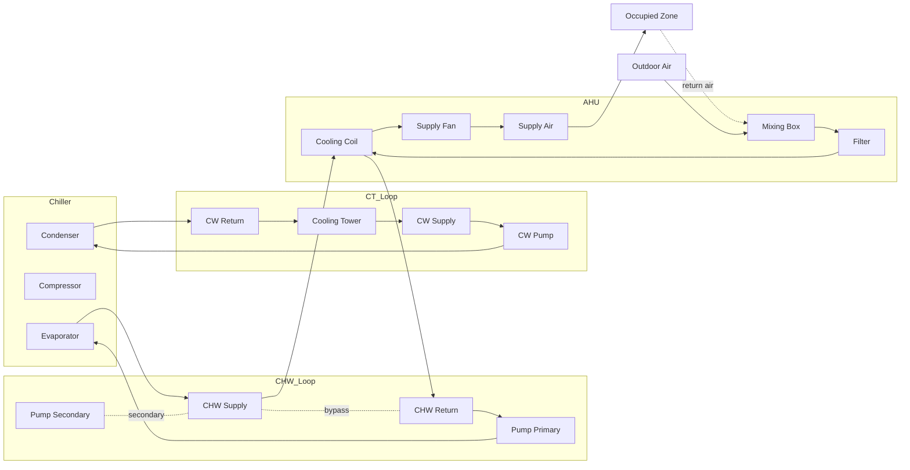
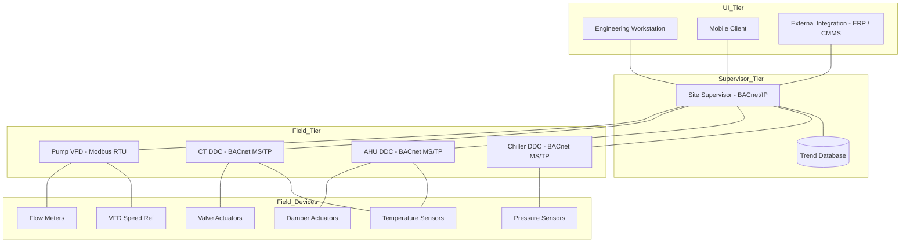

# System Overview

This document describes the typical architecture of an industrial HVAC and cooling system, the role of each major equipment class, and how the templates in this repository map to each component. It is the starting reference for technicians and planners new to the site and the canonical source for asset classification.

The information here is intentionally generic. Every site deviates in some respect — pump configurations, chiller staging strategy, BMS protocol, tower cell count. Use this document as a baseline; document site deviations in a site-specific addendum.

---

## 1. Plant Architecture

A typical industrial chilled-water cooling plant consists of four interlocked fluid loops, each with its own components, instrumentation, and failure modes. Understanding the loops and their interfaces is the foundation of any inspection or fault diagnosis.

### 1.1 Refrigerant Loop (within the Chiller)

The refrigerant loop is contained within the chiller package and is sealed at the factory. It comprises the compressor, condenser, expansion device, and evaporator, plus associated oil management, refrigerant drying, and safety controls. Centrifugal chillers use impeller-style compressors with inlet guide vanes or variable-frequency drives; screw chillers use twin-screw rotors with slide valves. Each architecture has characteristic failure patterns — surge on centrifugal machines under low-lift conditions, oil foaming on screw machines after a long shutdown — that the inspection templates capture.

Refrigerant types in scope for this repository are R-134a, R-123, and R-514A, all of which are commonly used in centrifugal and screw chillers in industrial and large commercial applications. R-123 (HCFC) is being phased out globally; R-514A (HFO blend) is its low-GWP successor. Sites operating R-123 equipment must plan conversion or replacement within the regulatory timeline applicable to their jurisdiction. R-134a (HFC) is permitted in most jurisdictions but subject to phase-down under EU F-Gas 517/2014; its long-term availability must be considered in lifecycle planning.

### 1.2 Chilled Water (CHW) Loop

The chilled water loop transports cooling energy from the chiller evaporator to the air handling units, fan coil units, and process loads. The loop is configured as either constant-volume with three-way bypass valves at the loads (legacy, 1970s–1990s) or variable-volume with two-way valves at the loads and variable-speed primary or primary/secondary pumping (modern). Variable-volume configurations save significant pumping energy but require differential pressure sensors at the hydraulically remote loads to control pump speed and prevent valve cavitation at low flow.

The CHW loop is sized for a typical temperature differential of 5–7 °C (9–13 °F) between supply and return. The supply temperature setpoint is usually 6–7 °C (43–45 °F); lower temperatures dehumidify better but risk coil freezing and require more chiller energy per kW of cooling. Higher differentials reduce pumping energy but require larger coils at the loads.

### 1.3 Condenser Water (CW) Loop

The condenser water loop rejects heat from the chiller condenser to the atmosphere via cooling towers or fluid coolers. The loop is sized for a temperature differential of 5–6 °C (9–11 °F), with supply to the chiller at 27–32 °C (80–90 °F) depending on outdoor wet-bulb. Tower approach (cold water temperature minus wet-bulb) is a key indicator of tower health — design approach is typically 3–4 °C (5–7 °F), and an increase indicates fouling, airflow maldistribution, or fill degradation.

Cooling towers carry the highest Legionella risk in a typical HVAC plant. ASHRAE 188 and AS/NZS 3666 mandate a water management plan with regular biocide treatment, drift eliminator inspection, and cleaning. These tasks are scheduled via the preventive maintenance templates and recorded in `cooling-tower-log.csv`.

### 1.4 Heat Rejection to Atmosphere

Heat rejection occurs in the cooling tower fill by evaporative cooling. Approximately 1% of condenser water flow is evaporated for every 5.5 °C (10 °F) of cooling range, which concentrates dissolved solids in the remaining water. A blowdown system, controlled by conductivity, periodically drains concentrated water and replaces it with fresh makeup to keep solids below the scaling threshold. Drift eliminators reduce water droplet carryover (and Legionella dispersal) to less than 0.005% of circulating flow on well-maintained towers.

### 1.5 Air Distribution

Air handling units condition and distribute air to occupied or process spaces. The AHU typically mixes outdoor air (for ventilation) with return air, filters the mixture, passes it across a cooling coil (CHW or DX), heating coil (HW, electric, or heat pump), and supply fan, and distributes conditioned air through ductwork to terminal devices (VAV boxes, grilles, diffusers). Modern AHUs often incorporate heat recovery (enthalpy wheels or heat pipes) to reduce outdoor air load, and variable-speed supply fans controlled by duct static pressure.

### 1.6 Controls Layer

A building management system (BMS) — also called a building automation system (BAS) — supervises plant operation through direct digital controllers (DDC) wired to sensors and actuators. The BMS provides trend logs, alarms, and scheduling. Common protocols include BACnet (most common in commercial HVAC), Modbus (common at the chiller/packaged unit interface), and LonWorks (legacy installations). Most sites are heterogeneous; integration gateways translate between protocols. The BMS is the primary source of operating readings logged in `operating-readings.csv`.

---

## 2. Equipment Inventory and Asset Classification

Every inspection and service record in this repository references an `asset_id`. The asset register (`templates/hvac-asset-register.csv`) is the master inventory and the foreign key for every other template. Asset IDs must be unique, stable across the asset's lifecycle, and structured so that a human can identify the equipment from the ID alone.

### 2.1 Recommended Asset ID Scheme

The scheme `<PLANT>-<TYPE>-<NNN>` is recommended. Examples:

| Asset ID | Interpretation |
|----------|----------------|
| `PLT-CHL-001` | Chiller 001 in plant room PLT |
| `PLT-AHU-014` | AHU 014 in plant room PLT |
| `PLT-CT-001` | Cooling tower 001 in plant room PLT |
| `PLT-PMP-CHS-001` | CHW secondary pump 001 in plant room PLT |
| `PLT-FAN-EXH-018` | Exhaust fan 018 |
| `FLR-3-FCU-007` | Fan coil unit 007 on floor 3 |

Plant room codes (`PLT`, `ROOF`, `FLR-3`) and equipment type codes (`CHL`, `AHU`, `CT`, `PMP`, `FAN`, `FCU`) should be documented in a site-specific addendum so that all team members use the same codes. Inconsistent codes are the single most common reason that asset registers become unreliable over time.

### 2.2 Criticality Classification

Every asset should carry a `criticality` value: `critical`, `high`, `medium`, or `low`. Criticality drives PM frequency, spare parts stocking, and redundancy planning. The recommended criteria:

| Criticality | Definition | Example |
|-------------|------------|---------|
| `critical` | Failure causes immediate loss of mission-critical service and has no installed redundant unit | Chiller in single-chiller data centre |
| `high` | Failure causes significant operational impact; redundant unit exists but with reduced capacity | Lead AHU in a hospital operating theatre suite |
| `medium` | Failure causes local discomfort or productivity loss; redundant capacity exists | Standard office floor AHU |
| `low` | Failure causes minor inconvenience; service can wait for next business day | Storage area exhaust fan |

Criticality should be reviewed annually. Equipment that has been supplemented with redundancy can be downgraded; equipment that has become load-critical (e.g. new server room added) must be upgraded.

### 2.3 Asset Lifecycle and Replacement Planning

The asset register carries `year_built` and `warranty_expiry`. These fields support two related but distinct planning activities. Warranty expiry triggers escalation of any new fault to the OEM before third-party servicing, to preserve warranty recourse. Lifecycle planning uses `year_built` together with equipment class typical service life (15–20 years for chillers, 15–20 years for AHUs, 15–20 years for cooling towers, 10–15 years for pumps and fans) to forecast replacement capital expenditure. A `notes` field captures lifecycle context such as "convert to R-514A by 2030" or "planned replacement in 2026 capex cycle".

---

## 3. Loop Topology Diagram

The diagram below shows a typical water-cooled chiller plant with primary/secondary CHW pumping, a cooling tower cell with associated condenser water pump, and a representative AHU serving a single zone. Not every site matches this topology; treat it as a reference baseline.

---

## 4. BMS Network Architecture

A typical BMS deployment on an industrial HVAC plant has three tiers: field controllers (DDC panels), a site controller or supervisor (which aggregates trends and alarms), and the user interface layer (workstations, mobile clients). Integration with the chiller package is typically via Modbus RTU or BACnet MS/TP at the chiller controller, while BACnet/IP is the dominant protocol between DDC panels and the supervisor.

The diagram below shows a typical three-tier BMS network for a single chiller plant. Sites with multiple plant rooms replicate this pattern per plant room and aggregate at the supervisor tier.

---

## 5. Equipment Class Details

The following subsections summarize each equipment class, the typical failure modes, and the primary templates used to document it. Detailed inspection procedures are in `inspection-methodology.md`.

### 5.1 Chillers

Chillers are the most complex and most maintenance-intensive equipment class in a typical HVAC plant. The chiller service record (`chiller-service-record.csv`) captures operating pressures, temperatures, electrical readings, refrigerant service events, oil condition, and parts replaced. The refrigerant service log (`refrigerant-service-log.csv`) records every refrigerant add, recover, or recovery-and-recharge event — required for regulatory compliance in most jurisdictions.

Common chiller failure modes include: high condenser pressure (caused by fouled condenser tubes, low CW flow, or non-condensables in the system), low refrigerant charge (caused by leaks at flanges, schrader valves, or rupture discs), oil contamination (caused by moisture ingress from a failed purge unit or low-side leak), and bearing wear (detected via vibration trending and oil analysis). The chiller service record and operating-readings templates are designed to capture the trend data that allows these failures to be anticipated rather than reacted to.

### 5.2 Air Handling Units

AHUs are air-side equipment that condition and distribute air. The AHU inspection checklist (`ahu-inspection-checklist.csv`) captures supply and return air temperatures, outdoor air percentage, filter differential pressure, fan electrical and mechanical condition, belt and bearing condition, coil cleanliness, drain pan integrity, and damper operation. Filter replacement is recorded separately in `filter-replacement-log.csv` because filter replacement is the most frequent PM task on an AHU and warrants its own trend data.

Common AHU failure modes include: coil freezing (caused by failed mixing dampers allowing 100% outdoor air below 0 °C), filter bypass (caused by poorly sealed filter frames allowing unfiltered air to bypass the media), condensate overflow (caused by clogged drain pans or dry traps), belt failure (caused by misalignment, incorrect tension, or wrong belt section), and bearing failure (caused by over-greasing, under-greasing, or shaft currents in VFD-driven motors). The AHU inspection checklist captures the data needed to detect each mode early.

### 5.3 Cooling Towers

Cooling towers are simultaneously the most reliable and the highest-risk equipment class in a typical plant. They have few moving parts (fan motor, gearbox or direct drive, float valve) but they aerosolize water and can amplify and disperse Legionella bacteria if water treatment fails. The cooling tower log (`cooling-tower-log.csv`) captures thermal performance, fan motor condition, water chemistry, and biocide dosing — the four indicators that determine whether the tower is operating safely and efficiently.

The mandatory water management plan required by ASHRAE 188 (US), EU F-Gas 517/2014 related guidance, and AS/NZS 3666 (Australia/NZ) is operationalized through scheduled tasks in `preventive-maintenance-schedule.csv`. Each task references the procedure in `inspection-methodology.md` and records completion in `cooling-tower-log.csv`. The traceability from schedule to record is essential for regulatory evidence and for incident investigation.

### 5.4 Pumps and Fans

Pumps and fans share most failure modes: bearing wear, shaft misalignment, imbalance, VFD-induced bearing currents, seal leakage, and impeller erosion. The pump-fan-bearing inspection template (`pump-fan-bearing-inspection.csv`) captures the common data — vibration, bearing temperature, motor electrical readings, oil/grease condition — for both equipment classes in a single schema. The `equipment_class` column distinguishes pump from fan from any future class (compressor, blower).

Bearing temperature trend is the leading indicator of bearing failure. A steady increase of 5 °C (9 °F) over a week, even within OEM limits, warrants investigation. Vibration trend is the second indicator; ISO 10816 vibration severity zones (A: good, B: acceptable, C: restrict, D: unacceptable) provide the framework for interpretation. The template captures both metrics in dual units to support international teams.

### 5.5 Building Management System

The BMS is the primary source of operating readings. The `operating-readings.csv` template is designed to receive exports from the BMS trend log with minimal transformation. Each row is one reading at one timestamp for one point. The `bms_point_id` field allows the same template to be used for any BMS point; the `point_class` field (temperature, pressure, electrical, frequency, state, position) supports filtering and aggregation.

BMS data integrity is often weaker than it appears. Sensor calibration drift, communication failures that produce stale values, and unit mismatches between the BMS point and the trend export are common issues. The `recordkeeping-guide.md` document describes how to validate BMS data before relying on it for trend analysis or regulatory evidence.

---

## 6. References

- ASHRAE Handbook — HVAC Systems and Equipment (latest edition)
- ASHRAE Handbook — HVAC Applications (latest edition)
- ASHRAE Standard 15 — Safety Standard for Refrigeration Systems
- ASHRAE Standard 90.1 — Energy Standard for Buildings Except Low-Rise Residential
- ASHRAE Standard 188 — Legionellosis: Risk Management for Building Water Systems
- EU F-Gas Regulation 517/2014
- EN 378 — Refrigerating systems and heat pumps — Safety and environmental requirements
- AS/NZS 3666 — Air-handling and water systems of buildings — Microbial control
- AS/NZS 5149 — Refrigerating systems and heat pumps — Safety and environmental requirements
- OEM manuals for each installed asset (site-specific, retained in maintenance office)
